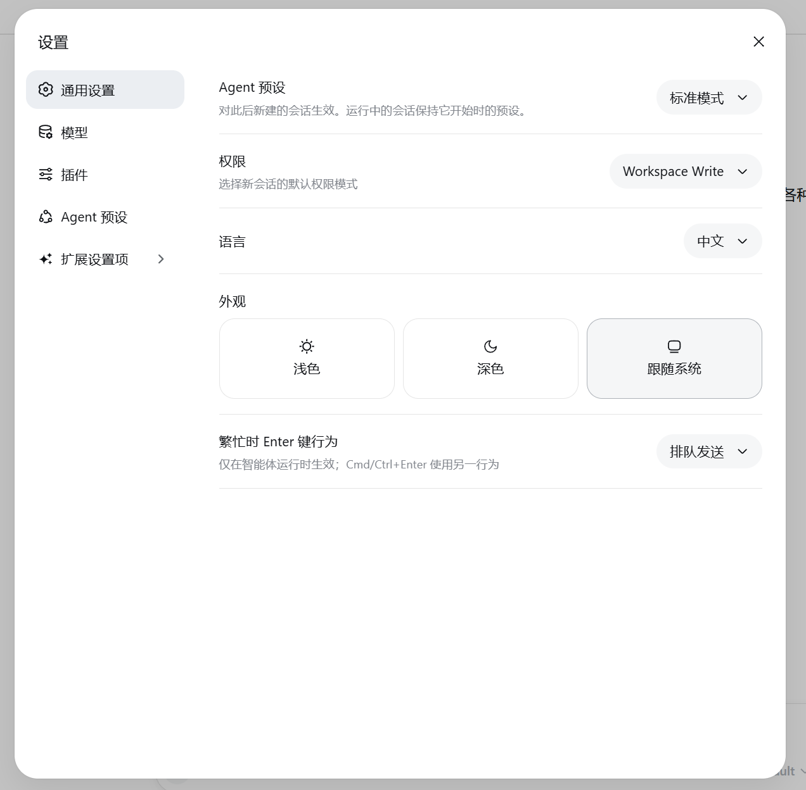
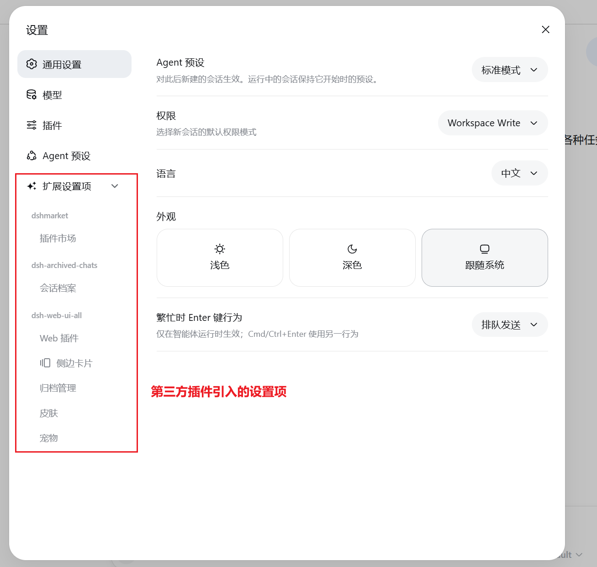

<div align="center">

# @aico/dsh-settings-hub

**把 DeepSeek Harness 第三方插件的设置项收进一个「扩展设置项」入口**

[](https://github.com/Amengclass/dsh-settings-hub/tree/aico/dsh-settings-hub)
[](LICENSE)
[](https://github.com/deepseek-ai/dsh)
[](https://github.com/Amengclass/dsh-settings-hub/tree/aico/dsh-settings-hub)

[English](README_EN.md) | 中文

</div>

> **AICO 内部分发版**：包名 `@aico/dsh-settings-hub`，独立分支 `aico/dsh-settings-hub` 的根目录就是本包（包即分支）。
> 公共版 `dsh-settings-hub` 在 `main` 分支；两者功能一致，只有包名和目录结构不同。

---

## Highlights

- **统一入口** — 所有第三方插件的设置项自动归入「扩展设置项」分组，不再散落在侧边栏各处
- **动态发现** — 新安装的插件自动出现，无需手动配置或修改代码
- **正确归属** — 按槽位注册来源（`registrant`）归属到父插件，取不到时用包名匹配兜底
- **拖拽排序** — 支持拖拽调整分组和子项顺序，顺序持久化到 localStorage
- **幽灵拖拽** — 拖拽时原位置保持不变，半透明幽灵跟随鼠标，视觉反馈清晰
- **零侵入** — 不修改 DSH 源码，通过官方 shadow 机制接管 `sidebar.settings` 插槽

## 工作原理

```
┌─────────────────────────────────────────────┐
│              DeepSeek Harness               │
│  ┌──────────────┐  ┌──────────────────────┐ │
│  │  原生设置项   │  │    扩展设置项 ▾      │ │
│  │  通用设置     │  │  ┌─ 插件分组 A ─────┐ │ │
│  │  模型        │  │  │  子项 1          │ │ │
│  │  插件        │  │  │  子项 2          │ │ │
│  │  Agent 预设  │  │  ├─ 插件分组 B ─────┤ │ │
│  │              │  │  │  子项 1          │ │ │
│  └──────────────┘  │  └──────────────────┘ │ │
│                    └──────────────────────┘ │
└─────────────────────────────────────────────┘
```

原生设置项（通用设置 / 模型 / 插件 / Agent 预设）保持原样，第三方插件的设置项自动折叠到「扩展设置项」下。

归属规则（DSH 0.2.x）：

1. 优先读取 live 槽位条目的 `registrant`，反查注册它的插件模块；
2. 取不到时，用 section id 匹配已安装包名（如 `market` → `dshmarket`）；
3. 仍无法归属的 section 单独成组，用其显示名命名，**不会被隐藏**。

## 截图

| 折叠状态 | 展开状态 |
|:--------:|:--------:|
|  |  |

## 快速开始

### 前置条件

- DeepSeek Harness **>= 0.2.0-rc.2**
- Node.js 18+

本分支是内部分发版，尚未发布到公共 npm 或部门 npm 源，推荐用本地 tarball 安装。

### 安装

**方式一：本地 tarball（推荐）**

```bash
git clone -b aico/dsh-settings-hub https://github.com/Amengclass/dsh-settings-hub.git
cd dsh-settings-hub
npm pack
dsh plugin --profile web add .\aico-dsh-settings-hub-0.2.1.tgz
```

也可以在 **DSH 设置 → 插件 → 添加插件** 里粘贴这个 tgz 的文件路径。

**方式二：AICO 插件市场**

收录进部门目录后，可在「AICO 插件市场 → 发现」里一键安装。当前版本尚未发布到部门 npm 源，暂用方式一。

**方式三：源码链接（开发调试）**

```bash
git clone -b aico/dsh-settings-hub https://github.com/Amengclass/dsh-settings-hub.git
cd ~/.dsh/profiles/web
npm link /path/to/dsh-settings-hub
```

### 启动

```bash
dsh web
```

打开 `http://127.0.0.1:3080`，点击左下角「设置」即可看到效果。

### 更新 / 卸载

```bash
# 更新：重新打包后覆盖安装（文件名随版本变化）
cd dsh-settings-hub
npm pack
dsh plugin --profile web add .\aico-dsh-settings-hub-0.2.1.tgz

# 卸载
dsh plugin --profile web remove @aico/dsh-settings-hub
```

## 配置

无需额外配置。安装后自动生效：

| 行为 | 说明 |
|------|------|
| 自动发现 | 读取 live `settings.section` 槽位，插件注册或注销后自动刷新 |
| 分组归属 | `registrant` → 包名匹配兜底；无法归属的 section 单独成组 |
| 拖拽排序 | 顺序保存在浏览器 localStorage，清数据后恢复默认 |

## FAQ

<details>
<summary>安装后看不到效果？</summary>

1. 确认插件已安装：`ls node_modules/@aico/dsh-settings-hub`（PowerShell 可用 `Test-Path`）
2. 重启 DSH：`dsh web`
3. 清除浏览器缓存后刷新
</details>

<details>
<summary>扩展设置项里没有某个插件？</summary>

该插件必须在客户端注册 `settings.section`。如果它的客户端模块没有加载，或被 DSH 的兼容性检查拒绝，就不会出现在分组里。
</details>

<details>
<summary>拖拽排序不生效？</summary>

排序保存在浏览器 localStorage 中。清除浏览器数据后排序会重置为默认。
</details>

## 开发

```bash
git clone -b aico/dsh-settings-hub https://github.com/Amengclass/dsh-settings-hub.git
cd dsh-settings-hub

# 收录前自检（零依赖，只用 Node 内置模块）
node script/verify.mjs

# 打包
npm pack
```

本地调试也可以 `npm link` 到 profile：

```bash
cd ~/.dsh/profiles/web
npm link /path/to/dsh-settings-hub
dsh web
```

### 项目结构

```text
dsh-settings-hub/          # aico/dsh-settings-hub 分支根目录
├── package.json          # @aico/dsh-settings-hub
├── cordis.patch.yml      # DSH bundle 层声明
├── index.js              # Node 端：HTTP API + 依赖扫描
├── modules/
│   └── client.js         # 浏览器端：设置面板 UI + 拖拽
├── locale/zh.json        # 插件标题/描述
├── assets/               # README 截图
├── script/
│   └── verify.mjs        # 收录前自检（不打包）
├── README.md
├── README_EN.md
└── LICENSE
```

## 贡献

本分支用于内部分发。功能问题请优先在 `main` 的 Issue 中反馈，或直接向本分支提交 PR。

## License

[MIT](LICENSE)
