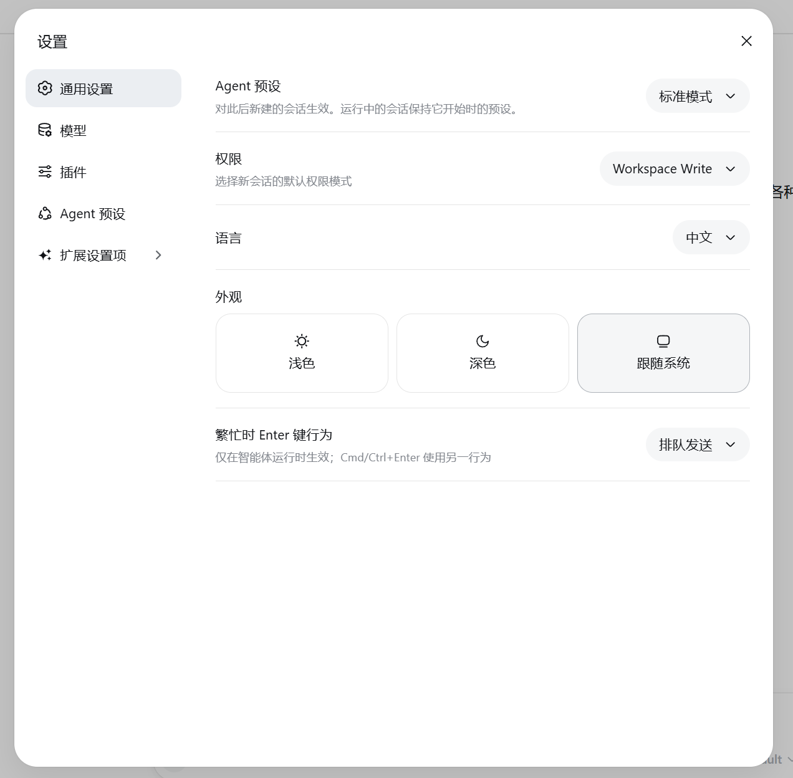
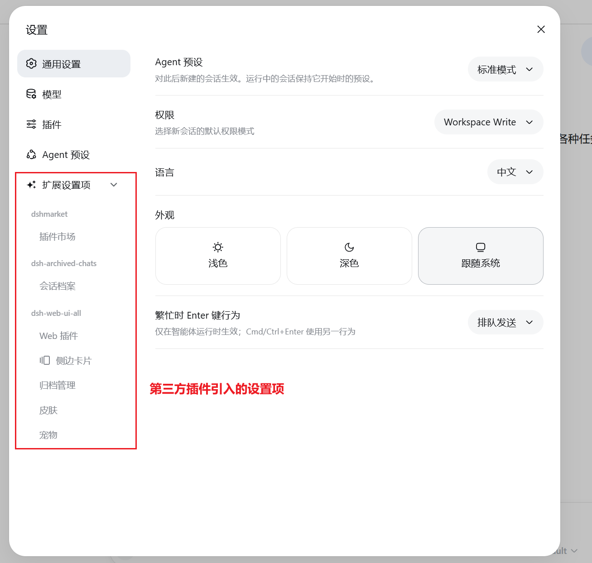

<div align="center">

# @aico/dsh-settings-hub

**Collects third-party DeepSeek Harness plugin settings under one "扩展设置项" entry**

[](https://github.com/Amengclass/dsh-settings-hub/tree/aico/dsh-settings-hub)
[](LICENSE)
[](https://github.com/deepseek-ai/dsh)
[](https://github.com/Amengclass/dsh-settings-hub/tree/aico/dsh-settings-hub)

English | [中文](README.md)

</div>

> **AICO internal build**: package name `@aico/dsh-settings-hub`; the root of the dedicated
> `aico/dsh-settings-hub` branch is the package itself.
> The public build (`dsh-settings-hub`) lives on `main`; features are identical, only the
> package name and layout differ.

---

## Highlights

- **One entry** — every third-party plugin's settings collapse into a single "扩展设置项" group
- **Auto-discovery** — newly installed plugins appear automatically, no configuration
- **Correct attribution** — grouped by the registering plugin (`registrant`), with package-name matching as fallback
- **Drag to reorder** — reorder both groups and child rows; order persists in localStorage
- **Ghost drag** — the original row stays in place while a translucent ghost follows the pointer
- **Non-invasive** — no DSH source changes; takes over the `sidebar.settings` slot through the official shadow mechanism

## How it works

```
┌─────────────────────────────────────────────┐
│              DeepSeek Harness               │
│  ┌──────────────┐  ┌──────────────────────┐ │
│  │  Native      │  │  Extension items ▾   │ │
│  │  General     │  │  ┌─ Plugin A ───────┐ │ │
│  │  Models      │  │  │  Item 1          │ │ │
│  │  Plugins     │  │  │  Item 2          │ │ │
│  │  Agent       │  │  ├─ Plugin B ───────┤ │ │
│  │  presets     │  │  │  Item 1          │ │ │
│  └──────────────┘  │  └──────────────────┘ │ │
│                    └──────────────────────┘ │
└─────────────────────────────────────────────┘
```

Native sections (General / Models / Plugins / Agent presets) stay untouched; third-party
plugin sections collapse under one "扩展设置项" group.

Attribution rules (DSH 0.2.x):

1. Read the live slot entry's `registrant` and resolve the plugin module that registered it;
2. If that fails, match the section id against installed package names (`market` → `dshmarket`);
3. A section that still cannot be attributed gets its own group named after its label — **nothing is hidden**.

## Screenshots

| Collapsed | Expanded |
|:---------:|:--------:|
|  |  |

## Quick start

### Requirements

- DeepSeek Harness **>= 0.2.0-rc.2**
- Node.js 18+

This branch is an internal build and is not published to public npm or the department npm
registry yet — install it from a local tarball.

### Install

**Option 1: local tarball (recommended)**

```bash
git clone -b aico/dsh-settings-hub https://github.com/Amengclass/dsh-settings-hub.git
cd dsh-settings-hub
npm pack
dsh plugin --profile web add .\aico-dsh-settings-hub-0.2.2.tgz
```

You can also paste the `.tgz` path in **DSH Settings → Plugins → Add plugin**.

**Option 2: AICO plugin market**

Once listed in the department catalog, install it from **AICO Plugin Market → Discover**.
The current version is not published to the department npm registry yet, so use Option 1 for now.

**Option 3: link from source (development)**

```bash
git clone -b aico/dsh-settings-hub https://github.com/Amengclass/dsh-settings-hub.git
cd ~/.dsh/profiles/web
npm link /path/to/dsh-settings-hub
```

### Run

```bash
dsh web
```

Open `http://127.0.0.1:3080` and click "设置" in the bottom-left corner.

### Update / uninstall

```bash
# Update: repack and reinstall (filename changes with the version)
cd dsh-settings-hub
npm pack
dsh plugin --profile web add .\aico-dsh-settings-hub-0.2.2.tgz

# Uninstall
dsh plugin --profile web remove @aico/dsh-settings-hub
```

## Configuration

No configuration needed. It works out of the box:

| Behavior | Description |
|----------|-------------|
| Auto-discovery | Reads the live `settings.section` slot; refreshes when plugins register or unregister |
| Group attribution | `registrant` first, package-name matching as fallback; unmatched sections form their own group |
| Drag reorder | Order is stored in browser localStorage and reset when site data is cleared |

## FAQ

<details>
<summary>Nothing shows up after install?</summary>

1. Verify the package: `ls node_modules/@aico/dsh-settings-hub` (on PowerShell, `Test-Path`)
2. Restart DSH: `dsh web`
3. Clear the browser cache and refresh
</details>

<details>
<summary>A plugin is missing from "扩展设置项"?</summary>

The plugin must register `settings.section` on the client. If its client module was not loaded,
or DSH rejected it as incompatible, it will not appear in the group.
</details>

<details>
<summary>Drag ordering does not stick?</summary>

The order is stored in browser localStorage. Clearing site data resets it to the default.
</details>

## Development

```bash
git clone -b aico/dsh-settings-hub https://github.com/Amengclass/dsh-settings-hub.git
cd dsh-settings-hub

# Pre-submission self-check (zero dependencies, Node built-ins only)
node script/verify.mjs

# Pack
npm pack
```

For local debugging you can also link it into a profile:

```bash
cd ~/.dsh/profiles/web
npm link /path/to/dsh-settings-hub
dsh web
```

### Project structure

```text
dsh-settings-hub/          # root of the aico/dsh-settings-hub branch
├── package.json          # @aico/dsh-settings-hub
├── cordis.patch.yml      # DSH bundle layer declaration
├── index.js              # Node half: HTTP API + dependency scanning
├── modules/
│   └── client.js         # Browser half: settings UI + drag & drop
├── locale/zh.json        # Plugin title/description
├── assets/               # README screenshots
├── script/
│   └── verify.mjs        # Pre-submission self-check (not packed)
├── README.md
├── README_EN.md
└── LICENSE
```

## Contributing

This branch is for internal distribution. Please prefer reporting functional issues on `main`,
or open a PR against this branch.

## License

[MIT](LICENSE)
